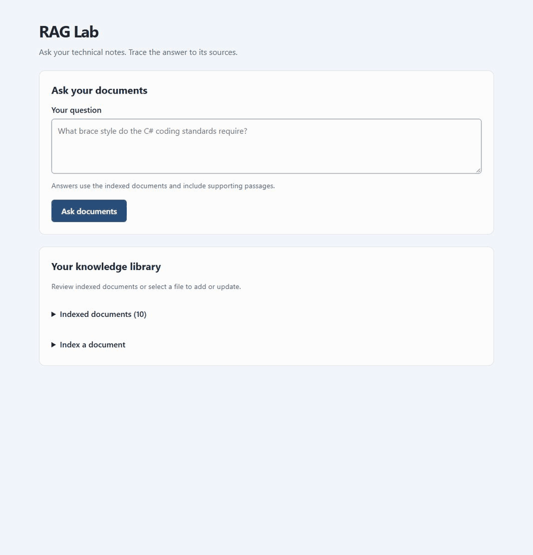

# RAG Lab

A local personal knowledge assistant built with .NET 10, PostgreSQL/pgvector, and Ollama. Stage 1 ingests explicitly selected Markdown and UTF-8 text files, retrieves relevant passages, and returns answers with citations through an API and a minimal browser interface.

**Verification status (2026-10-10):** build succeeded with zero warnings/errors; all **31 tests passed** (28 unit, three real-service integration), with none skipped. The HTTP smoke script passed indexing, unchanged detection, retrieval, cited answers, and unsupported-question handling. Stage 1 end-to-end acceptance is verified for the supplied sample corpus. See [verification](docs/project-notes/rag-lab/verification.md).

## See it in action

Ask **“What is the technical stack of RAG Lab?”** and follow the answer back to its supporting document.



Captured from the local Stage 1 application using the sample architecture document. Playback pauses are adjusted for readability; they do not represent inference timing. Answers may vary by model and indexed documents.

## Current status and development roadmap

**Current milestone: Stage 1 is implemented and verified locally.** The application can index selected Markdown/text documents and answer questions with source citations. It is a local MVP, with no public deployment or authentication yet. The next step is to evaluate a small set of real technical notes before starting the Dropbox connector. Stages 2–7 are planned and have not been implemented.

The project will grow in stages, keeping a working end-to-end application at each milestone:

| Stage | High-level plan | Status |
| --- | --- | --- |
| **1 — Local RAG engine** | Build the ASP.NET Core API, PostgreSQL/pgvector storage, Ollama embeddings/chat, local Markdown/TXT ingestion, safe index replacement, cited answers, tests, and a minimal browser interface. | Implemented; verified with the sample corpus |
| **2 — Dropbox connector** | Add OAuth and secure token storage, explicitly selected folders, manual synchronization, Markdown/TXT/PDF/DOCX ingestion, file IDs/revisions, and indexing progress/error reporting. | Planned; next development stage |
| **3 — Azure deployment** | Host the application in Azure Container Apps with PostgreSQL Flexible Server, Microsoft Foundry inference, Blob Storage, Bicep, database migrations, authentication/authorization, and basic monitoring. | Planned |
| **4 — Automatic Dropbox synchronization** | Add webhooks, cursor-based change discovery, queued indexing, explicit deletion handling, idempotent processing, retries, poison-message handling, and scheduled reconciliation. | Planned |
| **5 — React interface** | Replace the minimal browser interface with React + TypeScript + Vite, adding Entra ID login, conversations, document/source browsing, citations, retrieval diagnostics, and indexing status. | Planned |
| **6 — Cloud operations** | Establish GitHub Actions CI/CD, Azure OIDC authentication, managed identities, Key Vault, Application Insights, alerts, backup/recovery, rollback procedures, and cost monitoring. | Planned |
| **7 — Advanced RAG** | Evaluate hybrid search, reranking, retrieval/answer/citation accuracy, model benchmarks, source-code-aware indexing, additional connectors, caching, and performance/token monitoring. | Planned; after earlier stages are working |

The intended Stage 2 source is the Dropbox folder `/Knowledgebase`, synchronized on the primary Windows device at `C:\Users\mthou\Dropbox\Knowledgebase`. The connector will use Dropbox identities rather than device-specific local paths. This folder preference is recorded; the local index includes sample documents and explicitly selected repository notes.

## Prerequisites

For the primary development laptop's installed versions and setup/troubleshooting history, see [Windows setup](docs/project-notes/rag-lab/windows-setup.md). Readers setting up their own machine should follow the fresh installation instructions below.

- [.NET 10 SDK](https://dotnet.microsoft.com/download/dotnet/10.0). `global.json` accepts the latest installed .NET 10 feature band.
- For Visual Studio development, use a current Visual Studio 2026 release with the **ASP.NET and web development** workload. Visual Studio 2022 does not support this project's `net10.0` target. See Microsoft's [SDK and Visual Studio compatibility guidance](https://learn.microsoft.com/en-us/dotnet/core/porting/versioning-sdk-msbuild-vs). Terminal builds work with the standalone .NET 10 SDK.
- [Docker Desktop](https://docs.docker.com/desktop/setup/install/windows-install/) with Linux containers running.
- [Ollama for Windows](https://docs.ollama.com/windows), running locally. The two models require several GB of disk space; CPU inference may be slow.
- PowerShell; run commands from this repository's root. Ports 5432, 11434 and 5080 must be available.

There is no cloud setup, OAuth, React, or external account change in Stage 1. The existing MIT license and Git history are preserved.

## Start on this configured laptop

Local database credentials have already been generated in the ignored `.env` file and stored in the API's .NET user secrets. Preserve them; entering a new password will not change the existing PostgreSQL role password.

Open Docker Desktop and ensure Ollama is running, then:

```powershell
Set-Location C:\Repos\GitHub\mthouve\rag-lab
docker compose up -d --wait
.\scripts\Start-Local.ps1
```

Open [RAG Lab](http://127.0.0.1:5080). Both sample documents are already indexed on the primary development machine. The local startup helper reads the existing plain password from the ignored `.env` file and supplies the API connection string for that process, avoiding differences in user-secret discovery between terminals. It restores the caller's environment afterward. If Docker commands cannot find `docker-credential-desktop`, open a new terminal so it picks up the installed Docker PATH.

## Fresh installation (Windows PowerShell)

```powershell
Set-Location C:\Repos\GitHub\mthouve\rag-lab

dotnet --version
docker version
ollama --version

# Choose a LOCAL database password. Keep this terminal open for the API.
$localPassword = Read-Host 'Local PostgreSQL password' -AsSecureString
$env:POSTGRES_PASSWORD = [System.Net.NetworkCredential]::new('', $localPassword).Password
# Quote the password so spaces, semicolons and quotes are handled as data.
$quotedPassword = '"' + $env:POSTGRES_PASSWORD.Replace('"', '""') + '"'
$env:ConnectionStrings__Postgres = "Host=127.0.0.1;Port=5432;Database=raglab;Username=raglab;Password=$quotedPassword"

docker compose up -d --wait
ollama pull nomic-embed-text
ollama pull llama3.2:3b
Invoke-RestMethod http://localhost:11434/api/tags

dotnet restore RagLab.sln --configfile NuGet.Config
dotnet run --project src/RagLab.Api
```

Ollama's Windows application usually starts its server. If the tags request fails, run `ollama serve` in another terminal, then retry. Database schema initialization runs before the API starts, including `CREATE EXTENSION vector`; the local database user owns this database. Incorrect credentials, unavailable PostgreSQL, or incompatible database settings stop startup with a diagnostic.

Open [the local interface](http://127.0.0.1:5080). Index `sample-documents/rag-overview.md` and `sample-documents/postgresql-notes.txt` individually using the document form. The application never crawls your disk or automatically indexes a folder.

Docker stores the database in a named volume. `docker compose stop` preserves it. Changing `POSTGRES_PASSWORD` does not change the password in an existing database volume; keep the original value or explicitly change the database role password. Do not delete the volume unless you intend to erase the index.

For persistence across terminals, use .NET user secrets or a locally managed environment variable for `ConnectionStrings:Postgres`. Never put credentials in tracked JSON, source files, or shell history. `.env` is ignored and is consumed by Compose only, not by ASP.NET Core.

## Example HTTP requests

In a second PowerShell terminal:

```powershell
$base = 'http://127.0.0.1:5080'
Invoke-RestMethod "$base/health"
Invoke-RestMethod -Method Post "$base/api/documents/index" -ContentType 'application/json' -Body '{"path":"sample-documents/rag-overview.md"}'
Invoke-RestMethod -Method Post "$base/api/documents/index" -ContentType 'application/json' -Body '{"path":"sample-documents/postgresql-notes.txt"}'
Invoke-RestMethod "$base/api/documents"

$body = @{ question = 'How does RAG Lab preserve the previous index when an update fails?' } | ConvertTo-Json
Invoke-RestMethod -Method Post "$base/api/ask" -ContentType 'application/json' -Body $body | ConvertTo-Json -Depth 8

# Checks real HTTP indexing, unchanged detection, grounded answer, citations,
# and refusal of a question absent from the supplied sample documents.
.\scripts\Verify-Stage1.ps1
```

The smoke script assumes these sample documents are the active corpus. Other documents can legitimately change its expected unknown-answer result.

Example questions:

- How does RAG Lab preserve the previous index when an update fails?
- What are the default chunk size and overlap?
- What does pgvector's cosine similarity score mean?
- Why must the index be rebuilt when changing embedding models?
- What was Project Atlas's exact revenue in 2025? (Expected: insufficient information.)

`POST /api/ask` returns `answer`, `insufficientContext`, `citations` (used sources), and `retrieved` (all selected passages with scores). Each source includes its document ID, relative location, chunk ordinal and passage text. Citation IDs are local to an individual answer. An unchanged index result has `chunkCount: 0` to indicate no newly generated chunks; use `GET /api/documents` for the active count.

## Configuration

Use `Rag__PropertyName` environment variables or the `Rag` section in `src/RagLab.Api/appsettings.json`.

| Setting | Default | Meaning |
| --- | --- | --- |
| `AllowedRoot` | `../..` | Repository root, resolved relative to the API content root. Only explicitly selected relative `.md`/`.txt` files under this root are allowed; there is no directory crawling. |
| `ChunkSize` / `ChunkOverlap` | 1400 / 200 | Character windows and overlap; overlap must be smaller than the window. |
| `Dimensions` | 768 | Must match the embedding response and database vector column. |
| `EmbeddingModel` | `nomic-embed-text` | Used for documents and queries. |
| `ChatModel` | `llama3.2:3b` | Answer generation only. |
| `OllamaUrl` | `http://localhost:11434/` | Ollama HTTP base URL. |
| `TopK` / `MinimumScore` | 5 / 0.45 | Maximum retrieved passages and cosine-similarity cutoff. |
| `MaxFileBytes` | 1048576 | Selected file size limit; configurable up to 16 MiB. |
| `ConnectionStrings__Postgres` | none | Required; supply through environment or user secrets. |

Absolute paths, traversal outside the root, symbolic links and junctions are rejected. Root identity is saved in the database to prevent a different folder's relative names from overwriting the corpus. Windows source identities are case-insensitive. Identical text at two different paths remains two documents so citations preserve both source identities.

Changing chunk settings reindexes each selected document on its next indexing request. Changing the embedding model, dimensions, or source root against an existing database fails startup. Use a separate database in the same PostgreSQL instance or an explicit migration/reindex plan; equal dimensions do not imply model compatibility. Updating model weights under the same Ollama tag also requires deliberate reindexing; tag digests are not tracked yet.

## Tests

In Visual Studio 2026, set **RagLab.Api** as the startup project and select the **RagLab** launch profile. The profile enables a Development-only fallback to the repository's ignored `.env` password when no PostgreSQL connection string is configured. Explicit connection strings take precedence. The fallback accepts the generated plain local password; other password formats require an explicit connection string. It is disabled outside Development.

```powershell
dotnet test RagLab.sln

# Use a dedicated test database. The tests create/drop unique schemas,
# leave the public vector extension installed, and never drop the database.
# This uses the connection configured in the startup terminal above.
$env:RAGLAB_TEST_POSTGRES = $env:ConnectionStrings__Postgres
dotnet test tests/RagLab.IntegrationTests

# Opt in to tests that also call REAL Ollama models.
$env:RAGLAB_TEST_OLLAMA = '1'
dotnet test RagLab.sln
```

Without `RAGLAB_TEST_POSTGRES`, integration tests report **skipped**. Without `RAGLAB_TEST_OLLAMA=1`, the real-model test reports **skipped**. When enabled, connectivity failures fail the tests rather than being silently ignored. The database role must be able to create schemas and install pgvector.

## Architecture and limits

The API hosts a modular monolith. Application logic depends on `IDocumentStore`, `IEmbeddingProvider` and `IChatProvider`. Infrastructure implements Npgsql/Dapper SQL and Ollama HTTP calls. Embeddings are generated before a transaction atomically replaces one document's chunks. Queries use exact pgvector cosine search; the small initial corpus does not need an approximate vector index.

Stage 1 binds to loopback, rejects remote clients and cross-origin browser writes, and has no authentication. Keep it local. PDF/DOCX extraction, deletion synchronization, async workers, Azure deployment, React and Dropbox are deferred. `/health` checks PostgreSQL connectivity; it does not assert model availability. Validate Ollama using the tags request and smoke script.

The model can still misinterpret evidence. Structural citation checks cannot prove that every claim is supported. The score cutoff is a starting point, not a calibrated confidence measure. Character chunking can split words or sections, and oversized model inputs fail rather than silently truncate. Ingestion is synchronous and serialized within one API process. A changed root or model requires explicit migration; Stage 1's schema initializer is not a production migration system.

Recommended next task: try a small explicitly selected set of your own technical notes and assess retrieval/answer quality. Stage 2 (Dropbox) remains deferred until explicitly requested.

See [architecture](docs/project-notes/rag-lab/architecture.md), [decisions](docs/project-notes/rag-lab/decisions.md), and [learning notes](docs/project-notes/rag-lab/learning-notes.md).

Engineering conventions are documented in the [shared coding standards](docs/project-notes/rag-lab/coding-standards/README.md), with specific rules for C#, [HTML/CSS/browser JavaScript](docs/project-notes/rag-lab/coding-standards/html.md), and TypeScript/React.
