# Stage 1 architecture

```mermaid
flowchart LR
    F[Explicitly selected local MD/TXT file] --> A[Allowlist and bounded UTF-8 read]
    A --> H[SHA-256 and indexing profile]
    H --> C[Overlapping character chunks]
    C --> E[Ollama embedding provider]
    E --> DB[(PostgreSQL + pgvector)]
    UI[Minimal browser] --> API[ASP.NET Core API]
    API --> Q[Query embedding]
    Q --> DB
    DB --> P[Retrieved passages and scores]
    P --> L[Ollama chat provider]
    L --> V[Citation validation or insufficient information]
    V --> UI
```

## Application boundaries

`src/RagLab.Api/Application` contains chunking, hashing, ingestion, query orchestration, contracts, and interfaces. `Infrastructure` contains explicit SQL and provider HTTP calls. `Program.cs` supplies composition, schema initialization, endpoint mapping, local access checks and problem responses. `wwwroot` contains a dependency-free browser interface. These modules are in one assembly for Stage 1; provider replacement does not require changing the orchestration.

There are three actual projects: API, unit tests and integration tests. No empty Domain, Worker, frontend or Azure infrastructure projects have been added.

## Ingestion consistency

A document is identified by source type (`local`) and its path relative to the single allowlisted root. Windows paths are normalized to lowercase for identity. Metadata includes a stable UUID, source type, optional external ID/revision, filename, source location, content hash, indexing profile, last successful indexing timestamp, status and last error. Reserved external metadata fields are null for local files.

An unchanged hash/profile avoids embedding calls and restores a previous failure status if the active version still matches. Same contents at different paths preserve different source identities. SHA-256 describes the decoded UTF-8 content, after removing a leading BOM; it is not a file revision or cryptographic authenticity check.

The API serializes ingestion within its process. A changed document is fully embedded in memory before any index mutation. Replacement takes a transaction-scoped advisory lock for the source location, checks the expected previous hash, and atomically updates metadata, deletes old chunks and inserts the complete new set. Other transactions observe either the old committed version or the new committed version. Stale competing replacements fail with a retry message. No network inference runs inside this database transaction.

Failure recording retains the successful content hash, timestamp and chunks. A `failed` document with a previous successful version remains searchable; a failed first attempt has no chunks. Cancellation propagates without recording a document failure. Blank documents replace the previous version with zero chunks. Missing files are indexing failures, not inferred deletions. The schema has an explicit `deleted` status, but Stage 1 provides no deletion synchronization or endpoint.

## Retrieval and grounding

Document and question vectors use the same embedding model and dimension count. Nomic requests use the model's `search_document:` and `search_query:` prefixes. All vectors must have the configured length, finite values and nonzero magnitude. Vectors enter SQL as parameterized text cast to the vector type.

PostgreSQL computes exact cosine distance with `<=>`; similarity is `1 - distance`. Search filters by the configured threshold and returns the best `TopK` passages, source identities, offsets and scores. Exact search is intentional for the initial personal corpus.

The chat system message requires answers from supplied evidence only and treats passages/questions as untrusted data. The user message serializes question and passages as structured data. Ollama returns JSON containing the answer, insufficiency flag and cited passage IDs. The application adds missing inline markers from validated citation IDs and rejects unknown or inconsistent inline IDs and returns the insufficient-information message. Retrieved candidates remain available as diagnostics even when no answer can be supported. Structural validation reduces invented source references but cannot establish semantic entailment or guarantee prompt-injection resistance.

## Local operations

Compose binds PostgreSQL to `127.0.0.1:5432` and persists it in a named volume. The API binds to `127.0.0.1:5080`; Ollama defaults to localhost port 11434. Credentials are external configuration. Schema initialization takes an advisory lock, creates the extension/tables, and verifies database embedding model, dimension and source-root compatibility. JSON console logs record document identity, chunk counts and failures without logging document bodies or questions.

No paid cloud resources or external account changes are part of Stage 1. Later stages can replace model adapters and local sources, but require authentication, proper schema migrations and asynchronous processing before public deployment.

## Planned Dropbox source (Stage 2)

User-selected on 2026-10-10: `C:\Users\mthou\Dropbox\Knowledgebase`. This is the intended location for organizing knowledge documents in the Dropbox-synchronized folder on this Windows device.

The intended Dropbox-relative folder is `/Knowledgebase`. Stage 2 should explicitly select this folder through the Dropbox connector and use Dropbox file IDs/revisions for source identity. Other devices may have different local Dropbox root paths; the connector configuration must not depend on this Windows absolute path. Confirm the folder is accessible within the authorized Dropbox account/namespace during Stage 2 setup.

This records a future source preference only. Stage 1's local allowlist is the repository root; the active index includes the samples and explicitly selected project notes. Stage 2 implementation requires an explicit request.

## Repository-note indexing (2026-10-10)

To index the relocated notes without copying production documentation into `sample-documents`, the local `AllowedRoot` was expanded to the repository root (`../..` relative to the API content root). The existing database settings and two sample source locations were migrated in a single transaction, with preconditions verifying the previous root and document paths. Existing document IDs, hashes, chunks and vectors were retained; sample locations now start with `sample-documents/`.

Eight Markdown files under `docs/project-notes/rag-lab`, including all three coding-standards files, were explicitly indexed. This configuration permits selection of `.md`/`.txt` files within the repository; it does not crawl directories or change Dropbox settings. API source paths are now repository-relative, for example `docs/project-notes/rag-lab/coding-standards/csharp.md`.
